# Cineverse

A full-stack movie discovery application built with React and TypeScript, backed by a Node.js API and PostgreSQL. Cineverse combines an editorial cinema interface with persistent favorites, account management, and tested asynchronous UI flows.

The interface is in Vietnamese, with olive, ivory, and serif typography. This is a local-first portfolio project; no verified live application URL is published here.

## Demo Video

**Recording pending.** A 2–3 minute walkthrough is planned. See the [demo guide](docs/portfolio-demo-guide.md) for the script, test-account preparation, and privacy checklist.

## Screenshots

Fourteen application captures show the editorial interface across desktop and responsive layouts. The desktop homepage is the main preview. PNGs are losslessly optimized, preserving filenames, resolutions, and pixel content; see the [image inventory](docs/screenshots/README.md) for before/after sizes and review notes. Screenshots do not imply a public deployment or physical-device certification.

### Homepage

| Desktop — main preview | Responsive homepage |
| --- | --- |
| 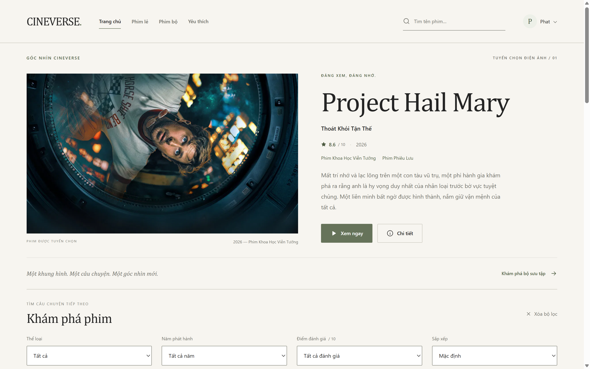<br>Editorial hero and movie discovery. | 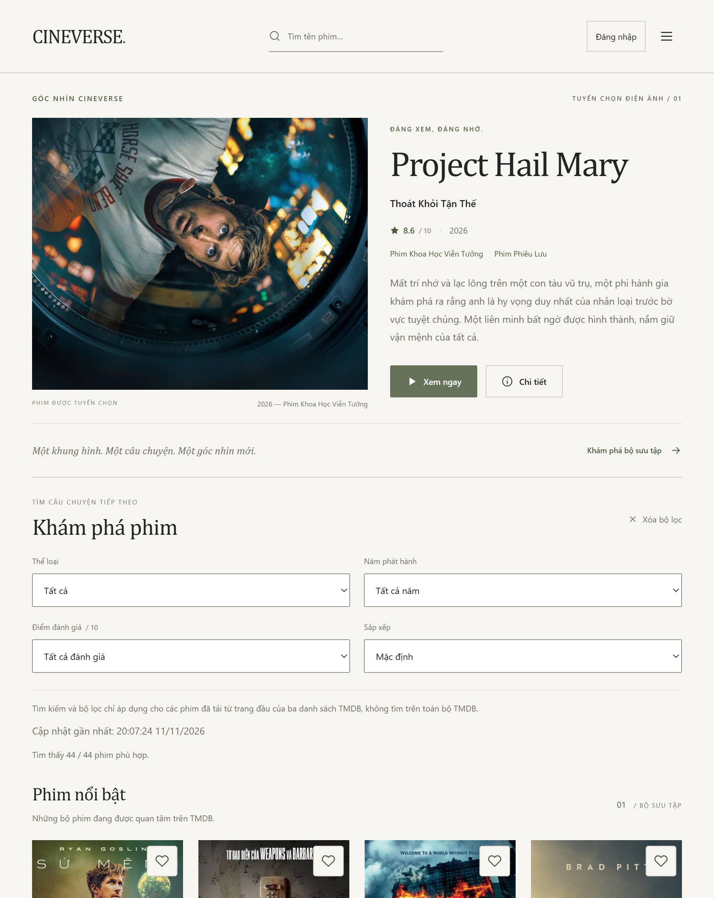<br>Compact navigation and adaptive filters. |

### Movie Discovery

| Explore movies | Browse collections |
| --- | --- |
| 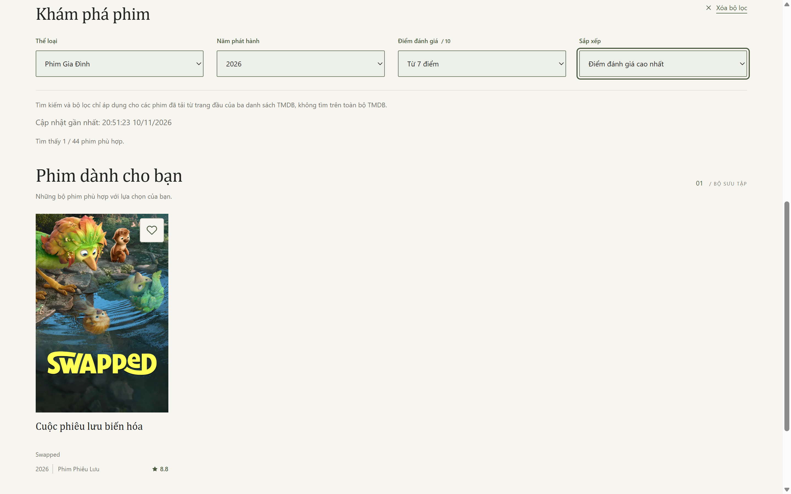<br>Combined filters and matching results. | 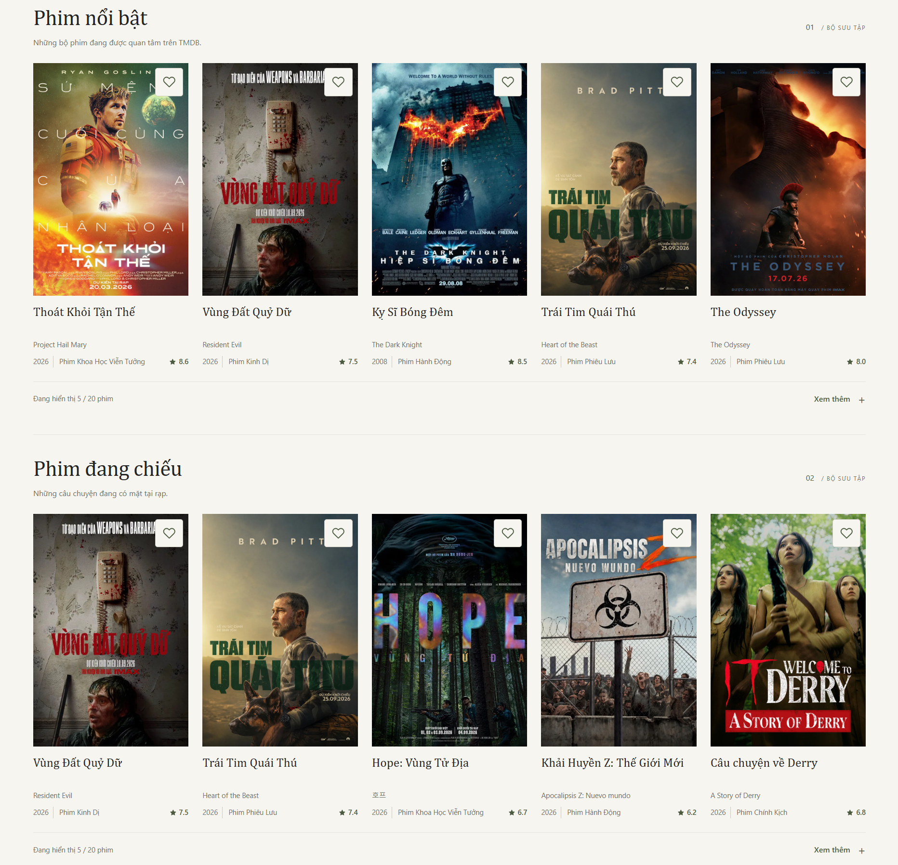<br>Popular and now-playing collections. |

### Details

| Overview & recommendations | Cast & responsive details |
| --- | --- |
| 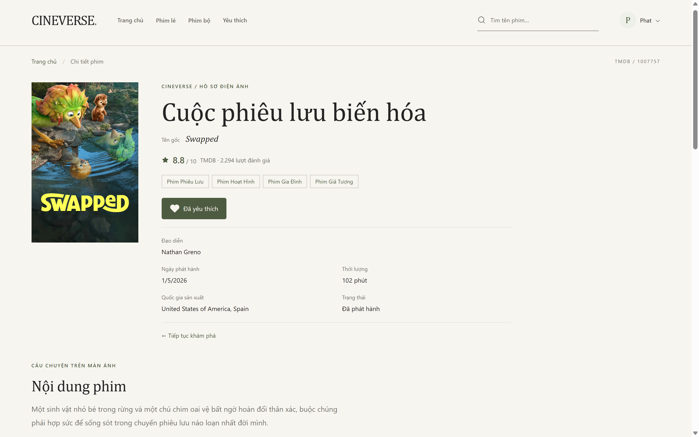<br>Movie metadata and favorite controls. | 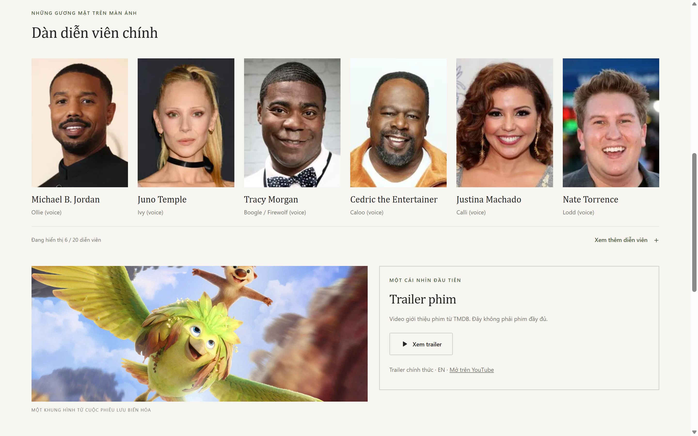<br>Top cast and on-demand trailer controls. |
| 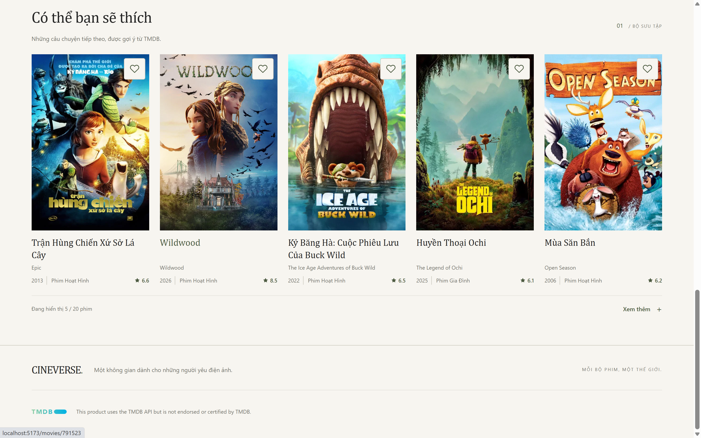<br>Related movies to explore next. | 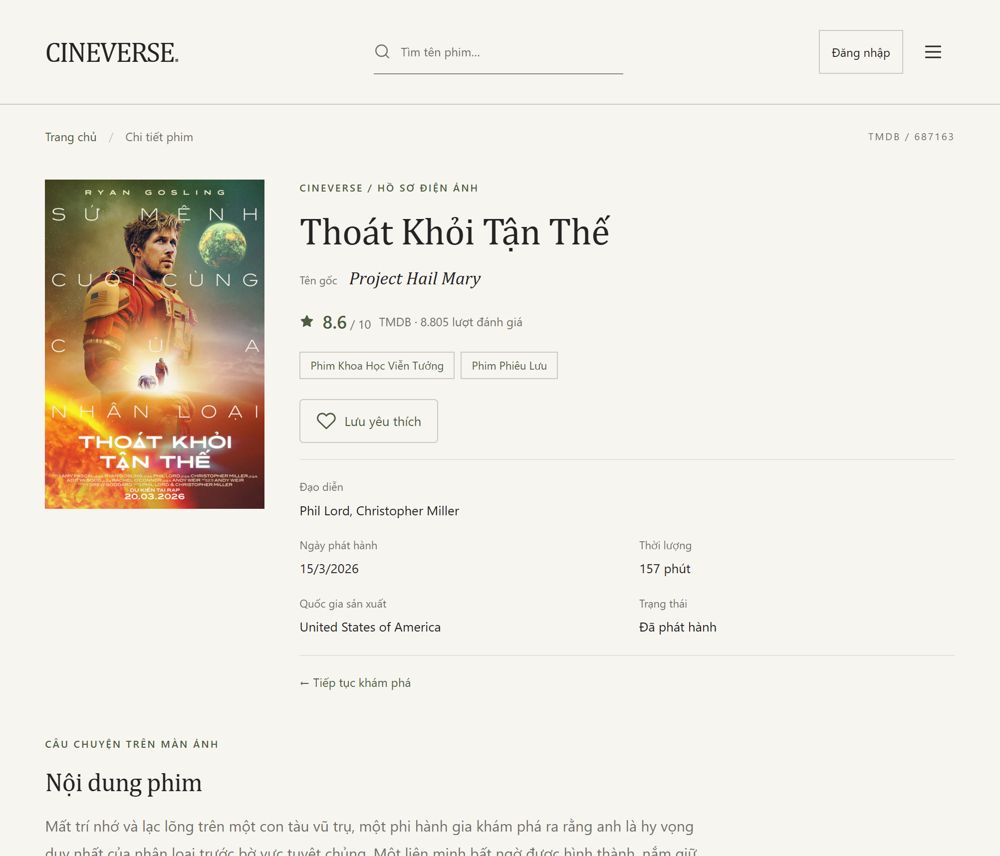<br>Responsive detail layout. |

### Authentication

| Login | Register |
| --- | --- |
| 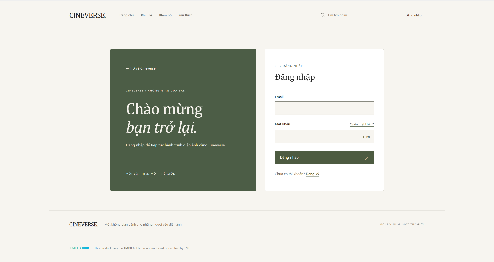<br>Login with an olive welcome panel. | 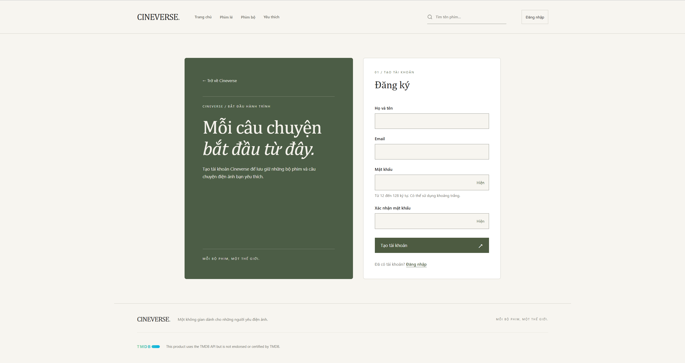<br>Registration with a consistent design. |

### Favorites

| Desktop favorites | Responsive favorites |
| --- | --- |
| 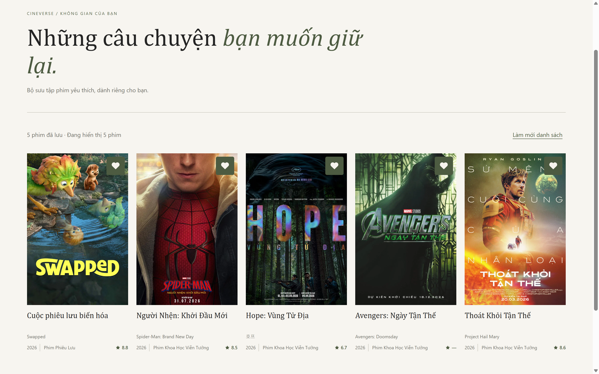<br>A personal collection of saved movies. | 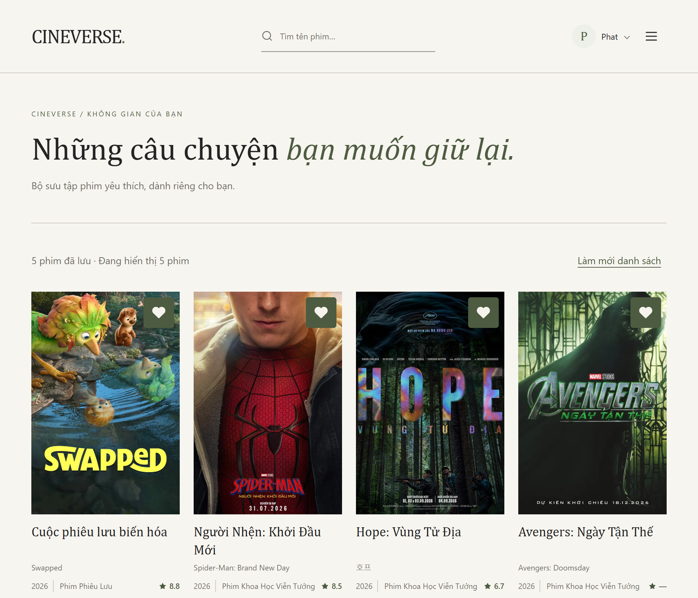<br>Saved movies in a responsive grid. |

### Mobile Responsive

Homepage, details, and favorites comparisons appear above. These additional captures show the adaptive collection grid and expanded navigation.

| Movie collections | Navigation |
| --- | --- |
| 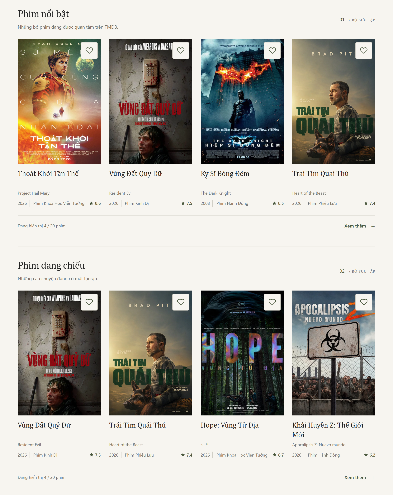<br>Adaptive movie collections. | 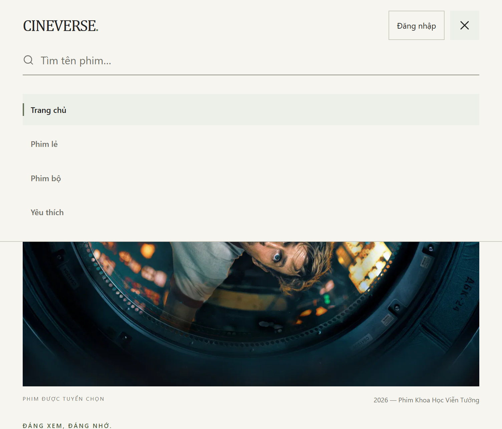<br>Expanded navigation and search. |

## Key Features

- **Movie discovery:** popular, now-playing, and top-rated TMDB collections, expandable rows, and loading, empty, error, and retry states.
- **Search and exploration:** case-insensitive title/original-title matching, combined genre/year/minimum-rating filters, sorting, result counts, and reset controls. These operate on the loaded first pages of three collections, not the entire TMDB catalog.
- **Movie details:** `/movies/:movieId` routes, metadata, directors, top cast, related movies, and on-demand YouTube trailers when available. Invalid IDs, missing images, and unavailable metadata have fallbacks.
- **Persistent favorites:** save/remove actions shared by cards and details, a protected favorites page, and server-side cursor pagination scoped to the signed-in user.
- **Accounts and profile:** registration, login/logout, session restoration, protected routes with return navigation, editable display names, favorite counts, and password changes that revoke existing sessions. Email is read-only.
- **Password recovery:** expiring single-use links and session revocation. Delivery requires a configured email transport; disabled or failed delivery is reported explicitly.
- **Responsive and accessible interactions:** mobile navigation, keyboard menus, visible focus, a skip link, route titles/focus management, favorite pressed states, and status/error announcements.

Cineverse is for discovery and trailers; it does not host or stream full-length films. Separate movie/TV navigation entries are disabled placeholders, not implemented catalog pages.

## Tech Stack

| Area | Technologies |
| --- | --- |
| Frontend | React 19, TypeScript 6, Vite 8, React Router 7, custom CSS |
| Frontend architecture | Context providers, custom hooks, typed API services, runtime JSON validation, data mappers |
| Backend | Node.js 22, native `node:http` server, JavaScript ES modules, REST endpoints |
| Database | PostgreSQL 17, Prisma 7, `@prisma/adapter-pg`, `pg` |
| Authentication | Server-side sessions, HttpOnly cookies, Argon2id, CSRF/Origin checks |
| Email | Nodemailer SMTP/local catcher support; optional Resend HTTPS transport |
| Quality | Node.js test runner, PGlite in-memory SQL fixtures, native PostgreSQL integration, Playwright, axe-core, Oxlint, GitHub Actions |

The backend is not Express-based. Exact dependency versions are recorded in the root and frontend lockfiles.

## Architecture

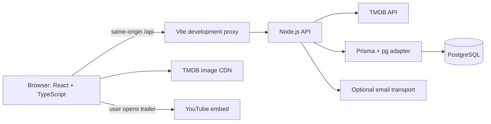

Pages consume custom hooks; services handle requests and validate responses before mappers produce application models. `AuthProvider` owns authentication state; `FavoritesProvider` isolates favorites by account and session epoch. The backend authenticates and authorizes private operations.

Movie requests pass through an allowlisted backend proxy, keeping the TMDB token out of the frontend. A shared scheduler bounds concurrency/queue size and deduplicates matching in-flight requests. Local development uses Vite's `/api` proxy. Same-origin static hosting support exists in the backend; cloud deployment remains a separate validation task.

## Project Structure

```text
frontend/
  src/
    components/    Reusable UI, forms, navigation, route boundaries
    pages/         Discovery, details, favorites, auth, profile
    contexts/      Authentication and favorites providers
    hooks/         Movie, profile, and favorites lifecycle hooks
    services/      Typed HTTP clients and response validation
    types/         API and application types
    utils/         Mappers, filters, validation, image helpers
  tests/           Frontend unit tests and browser suites
backend/
  auth/            Registration, sessions, recovery, account binding
  favorites/       User-scoped favorites endpoints
  profile/         Profile and password-change endpoints
  database/        Connections, migrations, role/ACL guards
  prisma/          Schema, migrations, drift-check baselines
  tests/           Backend and in-memory database tests
  integration/     Disposable native PostgreSQL tests
scripts/           Startup, quality gates, performance measurement
deploy/            Hosting environment templates
.github/workflows/ CI definition
docs/              Engineering notes and demo preparation
```

## Getting Started

### Prerequisites

- Node.js 22.18 or newer; [.node-version](.node-version) pins **22.23.4**.
- npm and Git. Install dependencies at both the root and `frontend/`.
- A TMDB **API Read Access Token** for real movie data. Obtain it privately through the [official setup](https://developer.themoviedb.org/docs/getting-started) and [application authentication guide](https://developer.themoviedb.org/docs/authentication-application).
- PostgreSQL 17 for accounts, sessions, favorites, and profile persistence. Movie discovery can run without a configured database.

### Install

```sh
git clone https://github.com/phat102004/movie-app-react.git
cd movie-app-react
npm ci
npm --prefix frontend ci
npm run db:generate
```

On Windows PowerShell, use `npm.cmd` if execution policy blocks `npm.ps1`.

### Configure the local backend

Use [backend/.env.example](backend/.env.example) as the template for a private `backend/.env`. Create it only if absent; preserve existing configuration. In PowerShell:

```powershell
if (-not (Test-Path backend\.env)) {
  Copy-Item backend\.env.example backend\.env
}
```

Set the TMDB token privately on the backend. Keep the template's local hosting settings; production modes and database policies are not local-demo requirements. Never put credentials in `VITE_*` variables, screenshots, command-line arguments, or Git.

For database-backed features, create a **dedicated local** database named `cineverse_dev`, schema `public`, on loopback port 5432. Configure its connection privately. The local guard rejects other targets. Then run:

```sh
npm run db:check
# Only after reviewing the dedicated local database and existing objects:
npm run db:migrate
npm run db:check
```

`db:check` is read-only. `db:migrate` writes the four reviewed migrations when pending, checking identity, history, and drift. It stops on unrecognized state; do not use reset/baseline commands to bypass it. There is no automatic account seed. Read the [local database setup](docs/phase-6.1-database.md) and [favorites schema notes](docs/phase-6.3a-favorites-database.md) before migrating an existing database.

### Run locally

```sh
npm run dev
```

This starts the backend on `127.0.0.1:3001`, waits for it to listen, then starts Vite, normally at `http://localhost:5173`. Open Vite's printed URL; Ctrl+C stops both processes. Restart after editing backend configuration.

If Vite selects another port, align the allowed authentication origin before testing accounts; local defaults cover port 5173. A missing TMDB token produces an explicit error state rather than a mock catalog.

For a frontend production build:

```sh
npm run build
```

Output is written to `frontend/dist`; building does not deploy the app. `npm start` runs the Node backend; default local mode does not serve the built frontend. Hosting startup requires the separately reviewed [Render/Neon setup](docs/phase-9b-render-neon-readiness.md).

Recovery is disabled until an email transport is configured. A local mail catcher can exercise recovery without Internet delivery; see the [recovery setup](docs/phase-6.2e-auth-refinement.md) and [demo guide](docs/portfolio-demo-guide.md).

## Environment Variables

Backend-only names are listed below; no credential values are included. Refer to the templates for configuration instructions. `NODE_ENV` is also consumed by the runtime.

| Purpose | Variable names |
| --- | --- |
| Movie data | `TMDB_READ_ACCESS_TOKEN` |
| Local database | `DATABASE_URL` |
| Server and origins | `NODE_ENV`, `HOSTING_MODE`, `HOST`, `PORT`, `AUTH_ALLOWED_ORIGINS`, `PUBLIC_APP_ORIGIN` |
| Recovery delivery | `PASSWORD_RESET_EMAIL_MODE`, `SMTP_HOST`, `SMTP_PORT`, `SMTP_SECURE`, `SMTP_FROM`, `SMTP_USER`, `SMTP_PASSWORD`, `RESEND_API_KEY` |
| Proxy limits | `TRUSTED_PROXY_CIDRS`, `TMDB_MAX_CONCURRENT`, `TMDB_MAX_QUEUE` |
| Deployment-only database controls | `MIGRATION_DATABASE_URL`, `PRODUCTION_DATABASE_HOST`, `DATABASE_SSL_CA_FILE`, `DATABASE_SECURITY_POLICY`, `DATABASE_PROVIDER_EVIDENCE_FILE` |

Deployment-only variables are not quick-start requirements. Runtime/migration credentials are separated. Managed PostgreSQL compatibility remains an explicit reviewed opt-in; this README does not enable it.

## Testing

Run from the repository root after installing both dependency trees and generating Prisma Client:

| Command | Coverage / purpose |
| --- | --- |
| `npm test` | Backend/frontend unit tests plus in-memory SQL fixtures |
| `npm run lint` | Oxlint for frontend, backend, and scripts |
| `npm run typecheck` | Frontend TypeScript project checks |
| `npm run build` | TypeScript check and Vite production build |
| `npm run db:validate` | Prisma schema validation |
| `npm run test:browser` | Hosting, auth, layout, favorites, profile, password change, multi-tab, accessibility, UX |
| `npm run test:a11y` | Production-build axe, responsive, and keyboard suite |
| `npm run test:ux` | Advanced UX validation entry point |
| `npm run check` | Unit/RAM tests, lint, TypeScript, build, Prisma validation, browser regression |

Browser suites use synthetic account/API fixtures and manage local servers; they do not require real TMDB or account credentials. Build first when running suites individually. Windows defaults to installed Edge. To use Playwright Chromium instead:

```sh
npx --no-install playwright install chromium
```

```powershell
$env:CINEVERSE_BROWSER_CHANNEL = 'chromium'
npm.cmd run build
npm.cmd run test:browser
```

On macOS/Linux, use `CINEVERSE_BROWSER_CHANNEL=chromium npm run test:browser` after building. Linux may need Playwright's `--with-deps` install step, as used in CI.

**Local documentation verification, 2026-11-10:** `npm test` passed **443 tests** (331 backend, 112 frontend); `npm run build` passed, including TypeScript. This is not a fresh browser/native PostgreSQL run or a statement about the latest GitHub Actions result.

[GitHub Actions](.github/workflows/ci.yml) runs on pull requests and pushes to `main`, with read-only repository permissions and two jobs: **Quality and browser regression**, and **PostgreSQL 17 native concurrency and least privilege**. The native job uses a disposable PostgreSQL 17.11 service, distinct bootstrap/runtime roles, migrations, real multi-connection tests, and privilege checks. Check the [actual workflow runs](https://github.com/phat102004/movie-app-react/actions/workflows/ci.yml) for current status.

Native tests are separate from `npm run check`. `test:postgres` requires the explicit disposable CI fixture; `test:postgres:local` creates a new loopback cluster using `CINEVERSE_PG_BIN`. Do not point them at developer/cloud databases. See the [CI/native test guide](docs/phase-7c-ci-production-readiness.md) for setup. [Performance measurements](docs/phase-8a-performance-optimization.md) are lab results, not field Core Web Vitals guarantees.

## Technical Highlights

- **Clear data boundaries:** external API types, runtime validation, and mappers separate TMDB payloads from UI. Start with [useMovies](frontend/src/hooks/useMovies.ts), the [TMDB service](frontend/src/services/tmdb.ts), and [movie mapper](frontend/src/utils/mapTmdbMovie.ts).
- **Async correctness:** deadlines, AbortController cleanup, stale-response checks, partial-result recovery, and retry behavior protect route changes and account transitions.
- **Multi-tab consistency:** BroadcastChannel/storage signals trigger server revalidation, with focus/visibility fallback. Sensitive requests carry an account precondition checked against the actual session; this assertion is not authorization.
- **Loading performance:** lazy routes, Suspense/error boundaries, responsive image sources, lazy posters, a prioritized hero, and deferred trailer iframes.
- **Accessibility regression coverage:** semantic controls, route focus/title handling, keyboard menus, and axe browser checks. Automation does not certify full WCAG compliance or replace assistive-technology testing.
- **Security boundaries:** HttpOnly sessions, hashed session/recovery tokens, Argon2id passwords, user-scoped queries, CSRF/Origin validation, trusted-proxy IP handling, and production role/ACL checks. Implemented controls are not a claim of production readiness.

## Project Status

The repository contains implemented discovery/account flows, quality gates, and hosting-readiness code. **No verified live demo URL is published here; cloud deployment is not complete.** Render/Neon provisioning, live TLS/ACL checks, email delivery, and staging validation remain separate work.

Fourteen screenshots are included above; video recording is still pending. UI copy is Vietnamese; search is limited to the loaded catalog, TV browsing/favorites are not implemented, email editing/avatar uploads are unavailable, and trailers depend on TMDB/YouTube. Complete recovery demos need a configured mail transport.

Engineering history is retained in [docs/](docs), including [architecture](docs/phase-5-architecture.md), [performance](docs/phase-8a-performance-optimization.md), [accessibility](docs/phase-8b-responsive-accessibility.md), [UX validation](docs/phase-8c-final-ux-validation.md), and [Managed PostgreSQL contract](docs/phase-9c3c-managed-postgresql-contract-v1.md).

## Future Improvements

- Complete staging provisioning, live security verification, and deployment before publishing a hosted demo.
- Extend discovery beyond loaded pages with API-backed search and pagination.
- Expand real-device, screen-reader, and real-user performance validation.
- Publish a reviewed video walkthrough to accompany the screenshot gallery.

These are planned improvements, not current features.

## TMDB Attribution

[](https://www.themoviedb.org)

This product uses the TMDB API but is not endorsed or certified by TMDB.

Movie metadata and artwork are supplied through TMDB; Cineverse does not claim ownership of them. The application footer also displays the logo and attribution notice. Preserve attribution in captures and follow the [official requirements](https://developer.themoviedb.org/docs/faq).
