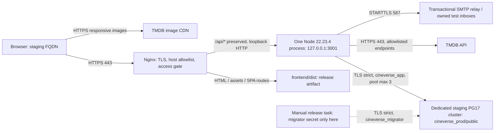

# Phase 9A — Staging architecture & hosting readiness

Ngày đánh giá: **31/10/2026**, baseline `d6893b7ca990c8ce53dc62a2b7dd416e62e18592`.
Đây là thiết kế, **chưa phải môi trường đã deploy**. Không đọc `.env`/credentials
thật, kết nối database, chạy SQL/migration, tạo account/resource, billing hoặc
commit/push. Hostname `.example` bên dưới là placeholder, không phải domain đã có.

Ký hiệu bằng chứng: **[Code]** đọc trực tiếp repository; **[Docs]** tài liệu chính
thức đã truy cập; **[Plan]** đề xuất cần thực hiện; **[Verify]** chưa kiểm chứng
trên tài khoản/provider. Giá chưa gồm thuế, domain, vượt quota và công vận hành;
cần xác nhận lại ở checkout trước khi cho phép phát sinh phí.

## 1. Quyết định đề xuất

**Chọn một VPS staging riêng, Nginx cùng origin + Node loopback + PostgreSQL 17
riêng**, nếu người vận hành nhận trách nhiệm cập nhật OS, TLS, backup và restore.
Hetzner x86 tại EU là mốc chi phí tham khảo; chưa chọn/mua server thực tế.

Lợi ích cụ thể so với A/B: kiểm soát được TCP peer và XFF, quyền DBA để đáp ứng
toàn bộ role/ACL guards, TLS hostname/CA và SMTP 587. Không cần đổi session/CORS
hoặc đưa frontend/backend sang hai origin. Backend loopback hiện tại phù hợp
topology này. Đây là lý do xem xét phương án C, không phải kết luận VPS luôn tốt
hơn managed hosting.

**Render trả phí + Neon là dự phòng ưu tiên nếu muốn giảm công vận hành**, nhưng
chỉ chuyển thành lựa chọn triển khai khi chứng minh được toàn bộ ACL và trusted
ingress policy. Chưa có bằng chứng Neon đáp ứng mọi guard của Cineverse. Railway
là lựa chọn khác, nhưng SMTP hiện tại đòi Pro và database template không đồng
nghĩa với dịch vụ DBA managed.

Nếu không có người chịu trách nhiệm vận hành VPS và A/B chưa qua feasibility
gates, kết luận là **NO-GO**, không hạ guard để triển khai cho được.

## 2. Current architecture và phụ thuộc local

| Thành phần [Code] | Hiện trạng và hệ quả staging |
| --- | --- |
| `frontend/src/main.tsx`, `App.tsx` | BrowserRouter, lazy pages, Auth/Favorites providers; URL trực tiếp cần SPA fallback. Reset fragment được xóa trước Router/Provider và HTTP requests. |
| `frontend/vite.config.ts` | Dev/preview `/api` → `http://127.0.0.1:3001`. Proxy này không đi vào `dist`; không dùng Vite dev/preview làm server production. |
| Frontend services | URL tương đối `/api/...`; `sessionHttp.ts` dùng `credentials: same-origin`, deadline 12s, CSRF/account headers. |
| `backend/index.mjs` | Node HTTP thuần, không Express; bind cứng `127.0.0.1:3001`, chưa đọc `PORT`/`HOST`. SIGTERM đóng server/connections và disconnect DB. |
| `backend/server.mjs` | Auth, Profile/Change Password, Favorites, TMDB proxy; không phục vụ `frontend/dist`, không CORS và chưa có health/readiness route. Base URL `http://localhost` chỉ dùng parse pathname, không phải upstream cần đổi. |
| `auth/config.mjs`, `cookies.mjs` | Production origin HTTPS chính xác; cookie `__Host-cineverse_session`, Secure, HttpOnly, SameSite=Lax, Path=/, không Domain; TTL 7 ngày, tối đa 5 sessions/user. |
| `auth/security.mjs` | Chặn Origin không nằm allowlist và `Sec-Fetch-Site: cross-site`; writes đòi `X-Cineverse-CSRF: 1`. Không phải CORS middleware. |
| `client-ip.mjs` | Mặc định socket-only; chỉ tin XFF khi peer nằm trong CIDR cấu hình, duyệt chain từ phải sang trái, chuẩn hóa IP; không trust-all. |
| `database/connection-config.mjs` | Dev/test chỉ local `cineverse_dev:5432`; production chỉ hostname xác định, `cineverse_prod/public`, cổng 5432, role riêng, TLS strict. `NODE_ENV=staging` bị từ chối. |
| `database/client.mjs` | PrismaPg + generated TS client; DB/role kiểm tra khi `getPrisma()` chạy lần đầu, không tự được chứng minh bằng việc HTTP port mở. Pool runtime tối đa 3, migrator 1. |
| SQL + deploy guards | Hai LOGIN roles không membership/INHERIT/superuser; migrator sở hữu 5 bảng kể cả history, runtime CRUD đúng 4 bảng. Chặn CONNECT database khác, extra ACL/routines/objects. |
| `production-readiness.mjs` | Offline validation hiện đòi cả runtime và migration URLs; không tích hợp vào startup, không kiểm chứng TLS/network/SMTP delivery. Recovery disabled vẫn được chấp nhận. |
| `auth/reset-email.mjs` | SMTP Nodemailer; production không nhận Mailpit/local mode. STARTTLS bắt buộc khi không dùng implicit TLS; deadlines, không debug SMTP/file access. |
| TMDB scheduler | Một scheduler/process: default 6 active, 32 queued, 256 waiters; upstream 8s, queue 2s; dedupe/cancellation, 503 busy và 504 timeout. Hai biến env chỉ điều chỉnh active/queue trong bounds. |
| CI | Hai jobs quality/browser và PostgreSQL native; Node pin 22.23.4, PG 17.11, lockfiles/actions pin, contents read, không deploy hoặc production secrets. |

Các dependency filesystem phải có trong artifact: `frontend/dist`, dependencies
Linux đúng lockfiles, `backend/generated/prisma`, schema/migrations/baselines và
scripts release. Client generated bị Git ignore nên phải generate khi build.
`backend/.env` chỉ là cơ chế local; staging inject environment, không ship file
đó. Public CA nếu dùng phải mount đường dẫn tuyệt đối; private key không thuộc
runtime artifact. Dữ liệu bền vững ở PostgreSQL, không nằm trong filesystem Node.

Đã đối chiếu toàn bộ docs [7C](phase-7c-ci-production-readiness.md),
[8A](phase-8a-performance-optimization.md), [8B](phase-8b-responsive-accessibility.md),
[8C](phase-8c-final-ux-validation.md). CI xanh/fixture không chứng minh ingress,
SMTP, certificate, backup/restore hay UX thiết bị thật. Publication 8C đã xác minh
[run 41170344834](https://github.com/phat102004/movie-app-react/actions/runs/41170344834)
cho baseline: quality/browser và 14 native tests đạt; không chạy CI mới ở 9A.

## 3. Hosting comparison

### 3.1 Chi phí và free tiers [Docs + estimates]

| Phương án | Cơ sở giá tháng | Hạn chế / kết luận |
| --- | --- | --- |
| A0: Render Static + Free Node + Neon Free | $0 trong quotas | Render ngủ sau 15 phút, wake khoảng một phút, chặn SMTP 25/465/587. Không đủ để nghiệm thu recovery bằng SMTP hiện có. Render DB Free hết hạn 30 ngày nên không dùng thay Neon. |
| A1: Render Static + paid Node + Neon Free | Node khoảng $7, static/DB $0 trong quota; mail Free nếu đủ điều kiện | Gói `0.5c-512mb` / legacy Starter. 512MB phải load-test Argon2/Node, không hứa đủ RAM. DB/proxy feasibility chưa qua. |
| B1: Railway full-stack + PostgreSQL template, Hobby | Floor $5 có credit $5; ví dụ usage khoảng $12.20 → bill $12.20 | Không phải $5 + $12.20. **SMTP bị tắt trên Free/Trial/Hobby**; cần email transport HTTPS được review riêng hoặc chọn Pro. Không tự đổi transport ở phase này. |
| B2: Railway Pro, cùng cấu trúc | Floor $20 có credit $20; bill = max($20, usage) | SMTP được hỗ trợ từ Pro. Persist DB cần volume; backup/storage/egress ngoài giả định phải tính thêm. |
| C: VPS riêng + local PG17 + SMTP relay | Mốc EU: €5.49 server + €0.50 IPv4 + €1.10 backup = **khoảng €7.09** | Thêm reserve €1–3 cho backup off-host; ngân sách sơ bộ **€8–12/tháng**, chưa VAT/domain/vượt traffic. Không phải hard cap hay báo giá Singapore. |

Nguồn giá Render: [giá own-service](https://render.com/articles/render-vs-railway),
[compute plan IDs](https://render.com/docs/compute-plans),
[Free limits](https://render.com/docs/free).
Neon Free hiện công bố 100 CU-hours/project/tháng, 1GB/project, scale-to-zero
sau 5 phút; restore window tối đa 6 giờ hoặc 1GB thay đổi. Không lấy quota cũ
0.5GB/50 CU-hours làm cấu hình hiện tại. [Neon pricing](https://neon.com/pricing).

Ví dụ Railway là **giả định**, không phải measurement: tổng Node+PG trung bình
1GB RAM, 0.1 vCPU, volume 1GB, egress 1GB → 1×$10 + 0.1×$20 + 1×$0.15 +
1×$0.05 = $12.20. CPU/RAM thực, filesystem cache, volume backup và build/runtime
topology có thể khác. Free chỉ có $1 credit/tháng, không phải full stack chạy
miễn phí vô hạn. [Railway plans/rates](https://docs.railway.com/pricing/plans),
[SMTP policy](https://docs.railway.com/networking/outbound-networking).

Mốc C lấy CX23 EU/new-order hiện tại, không dùng giá cũ €2.99/€3.99. Target
capacity là x86 2 vCPU/4GB cho staging nhỏ; phải xác nhận specs/stock trước mua.
[Giá điều chỉnh](https://docs.hetzner.com/general/infrastructure-and-availability/price-adjustment/),
[IPv4](https://docs.hetzner.com/cloud/servers/primary-ips/overview/),
[backup 20%](https://docs.hetzner.com/cloud/billing/faq/).
Không giả định đã sở hữu domain: reuse domain có quyền quản lý thì không thêm
phí đăng ký; nếu chưa có, lấy báo giá riêng trước billing. Công DBA/ops chưa tính.

### 3.2 So sánh vận hành

| Tiêu chí | A: Render + Neon | B: Railway | C: VPS riêng |
| --- | --- | --- | --- |
| Persistent data | Neon ngoài filesystem Node | PG volume riêng, không ephemeral container disk | PG data directory riêng trên VM disk bền vững; off-host backup bắt buộc |
| Node / PG17 | Pin Node 22.23.4; Neon hỗ trợ chọn PG17 | Pin Node; image PG17/digest được review, không tin default latest | Pin Node; cài PG17 x86, xác nhận server major/minor |
| DBA / least privilege | Không true superuser; SQL roles có thể hạn chế, toàn bộ strict ACL chưa chứng minh | Template PG không phải managed DBA; có thể tự cấu hình roles, phải kiểm tra bootstrap thật | Có quyền admin cluster riêng, khả thi bằng native PG; vẫn cần test thực tế |
| TLS / CA | HTTPS managed; Neon có TLS hostname verification | HTTPS edge; DB private CA/SAN cần verify và mount CA cho Node/CLI | Tự quản lý HTTPS renewal và DB CA/SAN, không dùng TLS-off vì cùng host |
| SMTP | Paid Node 587/465; Free không phù hợp | SMTP Pro trở lên | Hetzner cho 587; 25/465 bị chặn mặc định, chọn STARTTLS 587 |
| Domains | Static CDN/custom domain và web domain riêng; cần route /api đúng | Custom domain/TLS và API routing phải cấu hình | Một FQDN do mình quản lý, một ingress HTTPS |
| Sleep | Free Node + Neon có thể cold start; paid Node tránh sleep free | Serverless tùy chọn; DB pool có thể giữ awake; không mặc định hóa thành chi phí 0 | Không auto sleep, tính tiền cả khi power-off |
| Real client IP | Cần chứng minh trusted **ingress** peer/chain, không dùng outbound IP list thay thế | Tương tự, cần peer CIDRs/edge semantics đã xác minh | Nginx direct edge ghi đè XFF; Node chỉ tin loopback |
| Secret store | Platform secrets, tách runtime/release và project | Service/environment variables, tách DB admin và app | Restricted service credentials/runtime env, release credentials riêng; operator giữ quyền |
| Rollback | Artifact + selected service config; shared env groups/edge rules có ngoại lệ, không rollback SQL | Previous image + custom variables theo docs; DB volume/retention riêng | Release directory/manifest, atomic switch sau health; có maintenance window |
| Region | Node + Neon cùng Singapore nếu chọn A; static CDN | Singapore có sẵn; đặt app và DB cùng region | EU giá đã xác minh; latency tới VN/TH phải đo, SG phải báo giá khác |
| Backup / restore | Neon restore quota không thay backup ngoài provider | Volume backups/PITR phải bật/cấu hình, không coi template là có DBA DR mặc định | Tự làm logical backup, restore rehearsal; VM snapshot đơn lẻ không đủ |
| Nâng production | Dễ tăng compute/DB plan; role/proxy gates vẫn bắt buộc | Tăng limits/Pro/managed DB riêng; rà soát ops và shared quotas | Có thể tách DB/HA, nhưng phải thiết kế lại network/backup/quotas trước scale |

Nguồn compatibility/vận hành:
[Neon PG17](https://neon.com/blog/postgres-17),
[Neon TLS](https://neon.com/docs/security/security-overview),
[Railway PostgreSQL](https://docs.railway.com/databases/postgresql),
[Railway PG image](https://github.com/railwayapp-templates/postgres-ssl),
[Railway sleep](https://docs.railway.com/deployments/serverless),
[Railway backups](https://docs.railway.com/volumes/backups),
[Render rollback](https://render.com/docs/rollbacks),
[Railway rollback](https://docs.railway.com/guides/roll-back-bad-deploy),
[Hetzner SMTP](https://docs.hetzner.com/cloud/servers/faq/).
Regions: [Render](https://render.com/docs/regions),
[Neon](https://neon.com/docs/introduction/regions),
[Railway](https://docs.railway.com/deployments/regions).
Đây là capability theo docs; chưa xác minh latency, TLS hay backup trên account.

### 3.3 Không mặc định Static Site rewrite là authenticated API proxy

Render có rewrite URL và SPA fallback theo
[tài liệu](https://render.com/docs/redirects-rewrites), nhưng trang này không đủ
bằng chứng cho toàn bộ POST/PATCH/DELETE, Cookie, Set-Cookie, Origin, account/CSRF
headers và cache behavior cần ở đây. Phải thử các đặc tính đó trước khi dùng.
**Không dùng 301/302 để chuyển `/api` sang backend origin.** Nếu rewrite không
đáp ứng, dùng ingress/full-stack service thực cùng origin; không tháo bảo vệ cookie.

## 4. Recommended staging topology [Plan]



Một VPS, một Node process, không autoscale/cluster mode trong staging đầu.
PG dùng data directory riêng trên persistent VM disk trong dự toán; chưa mua
attached volume thứ hai và không giả định VM backup bảo vệ một volume bổ sung.
Nginx/Node/PG là ba OS services, không phải ba Node replicas. Node chạy user
không root; không đọc PG data directory/server key; PG chỉ bind loopback, không
mở public 5432. Public ingress chỉ 443/HTTP redirect 80 nếu cần; SSH giới hạn
operator IP/VPN. Staging chỉ cho tester qua IP/VPN/access gate; không đưa dữ liệu
production hoặc mở public registration/email để người lạ tiêu quota.

Canonical hostname: `staging.cineverse.example`; actual domain được chọn ở 9B.
DB dùng `db-staging.cineverse.example` resolve nội bộ/hosts tới loopback, SAN
certificate phải khớp FQDN. Đây không phải cách tắt TLS hoặc làm giả host identity:
`PRODUCTION_DATABASE_HOST` pin đúng tên, peer/certificate được verify thực.
Domain staging tách host production, không chạy hai origin UI song song; default
vhost từ chối Host lạ. Chưa bật CDN/proxy khác phía trước Nginx vì sẽ đổi trust chain.

## 5. Authentication, Origin và proxy policy

### Cùng origin là thiết kế chính

Browser tải SPA và gọi `/api` tại cùng scheme/host/port. Nginx giữ nguyên pathname,
query cần thiết, Cookie, Set-Cookie, Origin, Sec-Fetch-Site, CSRF/account headers;
không tạo hộ CSRF/account header, không đổi SameSite/Domain/Path, không cache API.
Backend dùng production config dù HTTP nội bộ loopback: Secure cookie do config
quyết định, không phụ thuộc socket nội bộ đã terminate TLS hay chưa.

Routing sketch cho 9B, **không phải config đã cài**:

```nginx
location /api/ {
    proxy_pass http://127.0.0.1:3001;
    # Không có slash cuối upstream: giữ /api trong URI.
    proxy_set_header Host $host;
    proxy_set_header Origin $http_origin;
    proxy_set_header X-Forwarded-Proto $scheme;
    proxy_set_header X-Forwarded-For $remote_addr;
    proxy_cache off;
}
```

Đặt `TRUSTED_PROXY_CIDRS` chỉ loopback được dùng thực tế. Edge trực tiếp ghi đè
XFF từ TCP peer; backend không public/bypass. Không trust-all, private subnet rộng
hoặc coi CF header/XFF tự khai là identity. Trên A/B cần nhà cung cấp xác nhận
ingress CIDRs/chain, kiểm tra hai client/quota và spoofing; **egress IP không phải
ingress proxy IP**. Docs Render mô tả XFF ở
[edge](https://render.com/articles/how-render-handles-ddos-attacks), không thay
bằng chứng về CIDR/overwrite cho deployment của mình.

Nginx không tự replay unsafe writes khi upstream fail. Session/cookie response
không đi qua CDN cache; JSON 400/401/403/429/503/504 và Retry-After phải còn nguyên.
Login luôn tạo session token mới như service hiện có; không tái sử dụng token
client tự cung cấp, không thêm rotation scheme khác hoặc ghi token vào storage.
Logout và password change/reset giữ semantics revocation đã kiểm thử. Favorite
in-flight đã xác thực có thể hoàn tất thuộc đúng owner theo policy 7B.5.

Tất cả tab dùng canonical origin: BroadcastChannel/storage signals vẫn hoạt
động trong scope đó; focus/visibility `/me`, epoch/cancellation và backend
`X-Cineverse-Account` binding được giữ. Proxy không được biến header account thành
nguồn phân quyền. Hai origin UI khác nhau không tự đồng bộ BroadcastChannel.

### Nếu buộc khác origin — chưa chọn, cần thiết kế riêng

| Trường hợp | Điều phải làm / giới hạn |
| --- | --- |
| HTTPS frontend/backend khác subdomain nhưng cùng registrable domain | Vẫn cross-origin: cần API base URL, `credentials: include`, OPTIONS/preflight, exact ACAO + credentials, allowlist methods/CSRF/account headers và Vary: Origin; code hiện chưa có. SameSite=Lax có thể phù hợp same-site, cookie vẫn host-only ở API host, không tự chia sẻ. |
| Frontend Render và backend Railway/custom domain khác site | Ngoài các mục trên, code hiện chặn Sec-Fetch-Site cross-site; Lax/third-party-cookie restrictions ngăn session. Không đổi sang SameSite=None, bỏ Origin hoặc cho `*` để né. Cần chọn cùng-origin gateway thay vì topology này. |
| Cookie domain | Prefix __Host- yêu cầu Secure + Path=/ + không Domain; không đặt Domain=parent để "share session". Staging/production không dùng chung DB/cookie host. |
| Login/logout/multi-tab | Cross-origin không chỉ là thêm CORS: phải test Set-Cookie, reads/writes, account switch, expired session, return URLs và signals scope. Không thay header binding bằng userId frontend. |

Tham chiếu [cookie attributes](https://developer.mozilla.org/en-US/docs/Web/HTTP/Reference/Headers/Set-Cookie),
[Fetch credentials](https://developer.mozilla.org/en-US/docs/Web/API/Request/credentials).

Recovery dùng `PUBLIC_APP_ORIGIN` là canonical HTTPS và nằm trong allowlist;
link `/reset-password#token=...` theo code, không dựng từ Host/XFF của request.
Giữ scrub fragment trước bootstrap, no-referrer/no-store trên HTML recovery,
không analytics/session replay ghi URL/token. Không bật open/click tracking cho
mail recovery; test link tới đúng staging, không production.

## 6. PostgreSQL feasibility và thiết kế quyền

**Cluster/project staging mới hoàn toàn**, không clone local hoặc production.
`NODE_ENV=production` để dùng security production; đây không phải tên môi trường
kinh doanh. Code hiện pin DB tên `cineverse_prod`, nên staging cũng dùng tên này
**trong cluster riêng**; khác host, credentials, backup namespace và owner inventory.
Không dùng cùng cluster/database thật production. Nếu muốn tên `cineverse_staging`,
đó là thay đổi identity guard cần thiết kế/test riêng ở 9B, không sửa ở 9A.

- Runtime `cineverse_app`: LOGIN, NOINHERIT, membership 0, không superuser,
  CREATEDB/CREATEROLE/replication/bypassRLS/owner/DDL; CRUD đúng bốn bảng.
- Migrator `cineverse_migrator`: credentials khác, không admin cluster, có CREATE
  trên target DB/public schema, sở hữu bốn bảng + `_prisma_migrations`.
- Bootstrap/DBA khác cả hai; chỉ dùng provision/grants/maintenance, không inject
  vào Node. Không grant runtime vào history, sequences không dùng, routines nguy
  hiểm hoặc migration role. PUBLIC CONNECT/TEMP database khác cũng phải xét.
- `DATABASE_URL` chỉ runtime; `MIGRATION_DATABASE_URL` chỉ release task. Hai URL
  cùng direct hostname pin + 5432 + schema public + đúng role, passwords khác nhau.
  Không truyền default provider owner URL cho app, không transaction pooler ở phase đầu.

| Provider | Khả năng và gate còn thiếu |
| --- | --- |
| Neon | [Docs roles](https://neon.com/docs/manage/roles) xác nhận Console/API/CLI roles có membership neon_superuser, không đạt guard. SQL-created roles không nhận membership đó, có thể selective grants. Nhưng chưa chứng minh quyền sửa ACL ở mọi database/default system database, ownership public, metadata/routines. Docs cũng yêu cầu SQL passwords dạng plaintext, không nhận pre-hashed; không mặc định `psql \password` của native provisioning tương thích. Cần phương thức khởi tạo secret không lộ SQL history/logs được provider xác nhận. |
| Railway PostgreSQL template | Có thể cấu hình native roles trong cluster do mình quản trị; chọn PG17 và inventory sạch. Không tự gọi đây là managed DBA. Private domain:5432 có thể phù hợp guard; public TCP proxy thường cấp port khác, không phù hợp. Public CA file và SAN private FQDN phải được chứng minh. |
| VPS PG17 | Có quyền DBA trên cluster riêng để kiểm soát cả PUBLIC grants ở postgres/template1, schema/owners/routines; thiết kế tương ứng SQL hiện có. Đây là feasibility của native Postgres, chưa phải role check đã chạy trên cloud. |

Không kết luận Neon chắc chắn thất bại hoặc chắc chắn pass từ docs chung. Gate
bắt buộc là inspect metadata thực cho **cả hai role** theo `role-security.mjs`:
`current_user=session_user`, membership 0, role flags, DB identity/CONNECT/TEMP/CREATE,
`otherDatabaseConnect=false`, schema/ownership, table/column grants, routines và
sequences. Provider-owned object/privilege không gỡ được → NO-GO hoặc chọn C;
không whitelist tùy tiện, xóa check hay nâng app lên provider owner.

SQL provisioning/grants hiện có là **manual only**. Chưa chạy chúng ở phase này.
DBA phải review target/backup trước, không chạy nguyên file vào DB có objects.
Sau migrate mới grant runtime; chỉ bốn bảng allowlist, không ALL TABLES/default
grants làm lộ history. Native CI 14 tests là bằng chứng trên cluster test có admin,
không chứng minh provider managed cho phép mọi thao tác đó.

## 7. TLS, SMTP và TMDB requirements

### Database TLS

App DSN contract hiện tại là `sslmode=require` + `sslaccept=strict`; driver thực
đặt `rejectUnauthorized=true`, `servername` đúng pinned hostname. Đừng hiểu
`require` riêng lẻ là hostname verification. Với Node/Prisma dùng builder hiện
có; pg_dump/psql/libpq dùng `verify-full` + CA phù hợp, không copy nguyên mọi
Prisma-specific query param sang libpq.
[PostgreSQL SSL verification](https://www.postgresql.org/docs/17/libpq-ssl.html).

C dùng certificate có SAN FQDN DB và CA công khai mount read-only vào Node và
release task qua `DATABASE_SSL_CA_FILE`; không đưa server/CA private key sang app.
CA private key do operator giữ riêng. Chứng minh wrong-CA/hostname/expired cert
bị từ chối; kết nối đúng dùng TLS. Chuẩn bị renewal và CA rotation có khoảng
overlap trust, không sửa thành rejectUnauthorized=false khi hết hạn.

Railway image hiện có private CA và có thể thêm private domain vào SAN theo
[init script](https://github.com/railwayapp-templates/postgres-ssl/blob/main/init-ssl.sh).
Điều đó không chứng minh certificate/volume đã deploy có SAN đúng hoặc Node đã
trust CA. Phải kiểm tra artifact/rotation thực, không ép dùng public proxy port
khác 5432 để vượt guard. Neon dùng direct TLS, không thêm params provider tùy ý
vào URL vì guard chỉ cho allowlist; translator/config change cần review riêng.

### SMTP

Chọn relay bên ngoài qua STARTTLS 587, giữ `requireTLS:true`, certificate checks
và deadlines hiện hữu. Hetzner docs cho phép 587; vẫn phải test outbound/DNS từ
VPS thật. Resend là **candidate** dùng được với Nodemailer SMTP hiện có, chưa tạo
account/key/domain: [SMTP settings](https://resend.com/docs/send-with-smtp).
Free công bố 3,000 mails/tháng, 100/ngày; không hứa deliverability hoặc free vượt
quota. [Pricing](https://resend.com/pricing).

Xác minh owned sender domain/SPF/DKIM/DMARC và inbox tester, tên gửi phân biệt
staging; không dùng credentials production. Unknown-email flow hiện cũng gửi
mail theo policy chống oracle: cần access gate + provider send cap, không tính
quota chỉ theo số registered users. Không chuyển sang HTTP mail API ở 9A.
Mailpit/disabled chỉ dành test hoặc nghiệm thu partial (503), không gọi đó là
password-reset end-to-end pass. Không debug nội dung mail/reset link trong logs.

### TMDB

Server-only `TMDB_READ_ACCESS_TOKEN`; backend outbound HTTPS tới TMDB allowlist,
browser ảnh tới image.tmdb.org. Không proxy tùy ý URL, không VITE_* token. Giữ
attribution, srcSet/lazy images, queue/dedupe/deadlines. Một Node process giữ
quota/scheduler per-process; restart/rolling overlap làm reset/nhân counters.
Không tăng replicas trước thiết kế shared quota; không thêm Redis ở phase này.
Stage smoke chỉ vài requests có giới hạn, không load-test TMDB thật.

## 8. Build, start, environment và health blueprint

### Artifact build, không secrets

Build Linux x86 sạch, pin Node 22.23.4/hai lockfiles; không copy node_modules
Windows. Build job không có `.env`, DB/TMDB/SMTP secrets, `NODE_ENV` chưa set
production khi chạy Prisma generate. Tách build khỏi runtime env: nếu set
production sớm, Prisma config đòi migrator URL và sẽ fail — không cấp migrator
secret cho frontend build để chữa lỗi đó.

```sh
# Blueprint cho build runner sạch; KHÔNG chạy các bước deploy ở Phase 9A.
npm ci --include=dev
npm --prefix frontend ci --include=dev
npm run db:generate
npm run build
```

Vite build tạo production assets; không đặt NODE_ENV=development xuyên suốt
frontend build. Artifact runtime chứa backend/generated + production dependencies;
artifact release/migration riêng còn Prisma CLI/schema/migrations/baselines.
Không prune mất CLI trước release task, không commit generated/node_modules.
Manifest ghi Git SHA, Node/PG version, checksums, public CA version và schema version;
không bake secrets vào artifact. Runtime lấy secrets riêng lúc khởi động.

Start command có sẵn: **`node backend/index.mjs`**, systemd/OS supervisor quản lý
user, restart bounded và shutdown. Chỉ dùng sau khi xử lý preflight/readiness 9B.
Không dùng `npm run dev`, Vite preview hoặc `npm start` chưa tồn tại. C giữ loopback;
A/B cần sửa bind đọc `HOST`/`PORT` để provider router vào được; hiện hai biến này
**chưa được index dùng**. Render yêu cầu
[0.0.0.0 / PORT](https://render.com/docs/web-services), Railway inject
[PORT/healthcheck](https://docs.railway.com/deployments/healthchecks).

### Biến môi trường: chỉ tên và trách nhiệm

| Scope | Names hiện có | Quy tắc |
| --- | --- | --- |
| Runtime non-secret config | `NODE_ENV`, `AUTH_ALLOWED_ORIGINS`, `PUBLIC_APP_ORIGIN`, `PASSWORD_RESET_EMAIL_MODE`, `PRODUCTION_DATABASE_HOST`, `DATABASE_SSL_CA_FILE`, `TRUSTED_PROXY_CIDRS`, `TMDB_MAX_CONCURRENT`, `TMDB_MAX_QUEUE`, `SMTP_HOST`, `SMTP_PORT`, `SMTP_SECURE`, `SMTP_FROM` | Production semantics + một canonical HTTPS origin; actual DNS/CA/proxy values chỉ chốt ở 9B. |
| Runtime secrets | `DATABASE_URL`, `TMDB_READ_ACCESS_TOKEN`, `SMTP_USER`, `SMTP_PASSWORD` | Chỉ staging, quyền đọc của runtime service; không frontend, Git, logs hoặc build image. |
| Release-only secret | `MIGRATION_DATABASE_URL` | Chỉ migration runner; runtime không có biến này/DBA credential. |
| Release preflight config | `NODE_ENV`, `PRODUCTION_DATABASE_HOST`, `DATABASE_SSL_CA_FILE` và origin/proxy/mail/scheduler names ở trên | `check:production-config` hiện cần cả hai URL trong task tin cậy, validate rồi đóng task; không gọi nguyên checker bằng cách cấp migrator cho HTTP process. |
| Provider port config (Plan) | `HOST`, `PORT` | Cần implementation/test 9B nếu chọn PaaS; không phải tính năng đã hoạt động. |

Release preflight/migration là job hoặc OS identity có secret scope riêng.
Không đặt migrator secret trong service env rồi chỉ `unset` ở lệnh start để coi
đó là đã tách secrets: container/parent process vẫn có thể giữ giá trị ấy.

Không phát minh JWT/session signing secret: session hiện là opaque token/hash
trong PG. Restricted env/credential files trên VPS nằm ngoài repo/web root,
không ship `backend/.env`, không echo env; SSH/DBA/backup identity tách runtime.

### Health/readiness [Plan, chưa có endpoint]

- Đề xuất `GET /api/health/live`: process đang phục vụ, 200 tối giản; không trả
  version/secrets/hostnames, không gọi external API.
- Đề xuất `GET /api/health/ready`: 200/503, no-store; production runtime config
  hợp lệ, generated client có, DB/role/schema gate đã pass và bounded DB probe.
  Readiness không gọi TMDB/SMTP mỗi lần, không gửi email hoặc chạy migration.
  Với C chỉ cho operator/loopback qua ingress ACL; không dùng browser hoặc
  public monitor dày để kích hoạt catalog/DB probes.
- Runtime-only preflight trước listen cần tách khỏi checker đòi migration URL;
  thiếu NODE_ENV/origin/token/DB/TLS hoặc SMTP theo scope phải fail trước mở traffic.
- Một HTTP port mở/GET `/me` trả 401 không đủ chứng minh DB role/TLS. Không dùng
  upstream movie call làm healthcheck; route hiện chưa có không được giả thành 200.
- Continuous probes có interval/budget, tránh giữ Neon Free compute awake vô hạn.
  Railway healthcheck triển khai không phải monitoring liên tục theo docs đã dẫn.

## 9. Release order, rollback và backup

**Chỉ là runbook 9B, không thực thi ở 9A.** Lần đầu có maintenance window và
chỉ một API process; chưa hứa zero downtime/HA.

1. Chốt provider/budget/owner/hostname; tạo target staging độc lập chỉ sau phê duyệt.
   DBA xác minh cluster identity, PG17, DB name/host và inventory; không dựa mỗi tên DB.
2. Provision roles theo SQL đã review trên empty target; init secrets qua kênh
   không ghi SQL/password vào lịch sử/logs; khóa PUBLIC grants cần thiết.
3. Build artifact sạch không secrets; CI đúng SHA phải có cả hai jobs success.
   Workflow hiện chỉ kiểm thử, chưa publish/deploy artifact. 9B dùng manual release
   đúng SHA sau gate; không bật provider auto-deploy main trước khi CI hoàn tất.
4. Release task inject riêng runtime/migration config để chạy offline
   `npm run check:production-config`. Sau đó chạy **`npm run db:deploy:production`**
   với migrator, Node env production và target staging pin đúng. Script này dùng
   Prisma migrate deploy + history/checksum/drift guards; không dùng `db:migrate`
   local, migrate dev/reset, tự baseline hoặc sửa migration đã publish.
5. DBA review/apply explicit runtime grants sau migrate; chạy
   `npm run db:roles:check` bằng runtime identity. Không đưa migrator secret vào
   runtime để checker pass; manual SQL và role checks là release gates riêng.
6. Start Node qua runtime-only preflight, readiness; Nginx giữ maintenance tới khi
   pass. Switch release HTML/backend hợp nhất; smoke auth/profile/favorites/reset.
7. Theo dõi lỗi/429/503/504, restarts, RAM/disk, TLS expiry, backup age và usage;
   schedule cleanup sessions bằng script sẵn có trên staging đúng guard, không local.

Rollback app dùng artifact/SHA trước còn tương thích schema, không Git reset/force
push hoặc auto down-migration. Nếu migration không backward compatible, giữ
maintenance, DBA chọn forward fix hoặc restore sang target mới rồi chuyển endpoint
có kiểm soát. Rollback artifact không tự hoàn tác SQL hoặc certificate files.
Render/Railway có cơ chế khôi phục service environment theo deploy, với ngoại lệ
về shared config tùy provider như các docs rollback đã dẫn. Vì vậy không giả định
env luôn giữ nguyên hoặc secret cũ vẫn hợp lệ: đối chiếu secret/CA version và
edge rules trong rehearsal. Không tự replay POST/PATCH/DELETE sau upstream reset.

Nginx phải ưu tiên `/api` trước SPA; `/assets/*` thiếu file trả 404 thực, không
HTML. HTML/routes/recovery no-store hoặc policy revalidation đã review; API luôn
no-store, no-referrer. Hashed JS/CSS/images public có immutable caching phù hợp,
giữ assets của release trước để lazy chunk đang mở còn tải được. Không xóa asset
cũ ngay lúc switch HTML; RouteBoundary explicit reload vẫn hoạt động khi file mất.

Backup C: logical snapshot hàng ngày gồm cả migration history, mã hóa off-host,
retention mục tiêu 7 daily + 4 weekly có giới hạn dung lượng; VM backup bổ sung,
không thay database restore test. Dùng DBA/maintenance identity đủ quyền, không
runtime (runtime cố ý không đọc history), không credential trong argv/artifacts GitHub.
[PostgreSQL dump permissions](https://www.postgresql.org/docs/17/backup-dump.html).
RPO 24h/RTO 2h là **mục tiêu chưa đo**, không SLA/PITR được bảo đảm.

Restore rehearsal vào cluster staging mới, không ghi đè local/production: chuẩn
bị đúng roles, restore owners là migrator, không tái nhập ACL rộng; review/grant
runtime sau restore, kiểm tra history/checksum/drift và CRUD/rollback. Backup chứa
PII/password hashes/auth token hashes nên phải restricted. Trước mở traffic của
copy được restore, DBA cần vô hiệu hóa sessions/reset tokens được khôi phục để
không hồi sinh session đã revoke/link đã dùng; không chạy thao tác này trong 9A.

## 10. Blockers, test strategy và risk register

| ID / mức ưu tiên | Bằng chứng / ảnh hưởng | Kế hoạch tối thiểu 9B và test bắt buộc |
| --- | --- | --- |
| B01 / chặn PaaS | Index hardcode loopback/3001; Vite proxy không có trong dist | Nếu A/B: bind env có validate, static/API routing cùng origin. Test port do platform cấp, SPA refresh, missing asset 404, API không fallback HTML; không Express rewrite toàn server. C tránh blocker bind nhưng vẫn cần ingress config. |
| B02 / chặn public staging | Chưa có health/readiness; config checks không chạy trước listen, DB lazy | Runtime-only startup gate và minimal endpoints; tests missing env/generated client/wrong role/CA/host → không ready, DB down → 503; không yêu cầu migrator secret ở app. |
| B03 / chặn A/B chưa có bằng chứng | Strict DB checks vượt "hai usernames riêng"; managed ACL/password setup chưa chứng minh | Disposable target + metadata của hai login roles, negative grants/other DB access, ownership/routine checks. Không xóa guard nếu provider không cho revoke; chọn C hoặc quyết định policy riêng được review. |
| B04 / chặn public traffic | Proxy CIDR/overwrite thật chưa được xác minh | Hai clients có quota riêng, spoof XFF không bypass; không bypass Node ingress. C loopback edge có policy xác định; A/B cần provider proof, không đoán private subnet. |
| B05 / chặn recovery acceptance | SMTP provider, DNS, TLS/delivery chưa kiểm tra | Owned inbox known/unknown email, invalid/reused/expired reset token, timeout/outage → lỗi an toàn, revoke sessions; không cần đổi auth policy. |
| R01 / High vận hành | Một VPS là single failure domain/OS responsibility | Operator, patch/restore rehearsal, bounded restart/disk alerts; không gọi cấu trúc này production HA. Nếu không quản trị được thì NO-GO. |
| R02 / Medium chi phí/UX | Free sleep/quota + frontend 12s deadline; Neon health pings giữ awake | Paid backend cho full recovery; đo cold idle path thật, không tăng mọi deadline hay ping giữ free service awake. |
| R03 / Medium scale | Rate limit/scheduler per process; rolling overlap/restart thay counters | Một process + maintenance rollout ban đầu; shared quota là prerequisite trước multi-instance, không tự thêm hạ tầng ở 9A. |
| R04 / Medium TLS/rollback | Cert renewal, CA rotation, stale chunks hoặc schema incompatibility | Wrong-host/CA rejection, overlapping CA rotation, retain hashed assets, rollback rehearsal trên DB mới. |
| R05 / High dữ liệu | Backup có PII và có thể hồi sinh sessions/reset tokens khi restore | Encryption/access/retention, không production data ở staging; invalidate restored auth state trước traffic, DBA review trên copy riêng. |
| R06 / chưa xác minh | EU/SG latency, SMTP delivery, accessibility thiết bị thật | Đo cùng network/cold-warm conditions; 8A lab không là field CWV. NVDA/VoiceOver, zoom thật, mobile/keyboard và forced-color checklist 8C còn cần staging walkthrough. |

Không tìm thấy lý do để đổi schema/migrations/session/CSRF/Origin ở 9A. Những
blockers trên là deployment gaps/feasibility, không được tự đánh dấu resolved từ CI.

## 11. Cost controls và checklist Phase 9B

- [ ] Người dùng chọn C hoặc A/B sau feasibility proof, duyệt chi phí **trước**
  account/billing/resource. Một staging project, một VM/API process, không preview
  environments/replicas/paid add-ons tự sinh.
- [ ] Xác nhận giá/region/stock/tax/domain và backup off-host; reserve không phải
  spending cap. Render instance cố định vẫn có egress/build/workspace overage.
- [ ] Neon Free giữ giới hạn, không auto upgrade/bật billing. Đếm compute khi
  probes/pool giữ awake: giả định 0.25 CU × 730h ≈ 182.5 CUh, vượt 100 free nếu
  luôn awake; đừng dự toán $0 cho workload 24/7 đó.
- [ ] Railway nếu chọn: cấu hình compute hard limit + alerts và replica/resource
  limits; hard limit làm workloads offline, không phải SLA và không xóa subscription.
  [Cost control](https://docs.railway.com/pricing/cost-control).
- [ ] VPS: bật billing/traffic alerts, không coi alert là hard cap. Power-off
  vẫn bị tính tiền; IP không gắn VM vẫn có phí. Chỉ deprovision sau backup/restore
  và quyết định owner; không tự xóa resource. [Billing rules](https://docs.hetzner.com/cloud/billing/faq/).
- [ ] Mail Free có quota và access gate; không tự nâng plan, không open/click
  tracking reset links, không bật SMTP debug. Logs/backup retention phải bounded.
- [ ] Implement nhỏ theo B01/B02 nếu cần, giữ auth API contract. Test lỗi cấu hình
  trước mở port, readiness độc lập upstream, proxy/role/TLS negative cases.
- [ ] Review Nginx/systemd/PG TLS/firewall và secret injection; frontend build có
  **không** runtime secrets; runtime có **không** migrator/admin secret.
- [ ] Sau phê duyệt provisioning: chỉ tạo staging mới, role/TLS test trước migrate;
  release script/grants/role check đúng thứ tự; backup/restore rehearsal trước user test.
- [ ] HTTPS browser: Login/logout/Me, reload/Back/Forward/direct routes, Favorites,
  Profile/password change, reset link, session expired và hai tab A/B; 403 binding
  còn hoạt động qua ingress, cookie attributes đúng trên host staging.
- [ ] Full CI, `check`, native isolated tests, browser/axe/keyboard/UX regression;
  performance compression/cache/lazy images; manual screen-reader/zoom/mobile.
- [ ] Release đúng SHA, rollback drill, quan sát quotas/CPU/RAM/disk/mail; chỉ chốt
  readiness sau evidence thật. Chưa triển khai production ở 9B nếu không được yêu cầu.

## 12. Validation thực hiện ở Phase 9A

Chỉ tạo tài liệu này. Không đổi `.env`, source, dependencies, workflow, schema,
migration hay Git remote; không chạy startup/config checker có secrets, DB checks,
provision/deploy/cleanup hoặc tests gửi mail. Chạy kiểm tra Markdown local links,
Git whitespace/scope và quét pattern secrets trên nội dung Git-visible, không
đọc `.env` thật hoặc environment credentials. Kết quả:

| Kiểm tra thực sự đã chạy | Kết quả |
| --- | --- |
| Git scope | Chỉ một file mới `docs/phase-9a-staging-architecture.md`, không staged/commit/push |
| Relative Markdown links | 4/4 tồn tại trong repository |
| Whitespace / fenced blocks | Không trailing whitespace, code fences cân bằng |
| Pattern secret scan | 287 Git-visible working files, 20 commits/468 history blobs; 0 findings sau phân loại fixtures/checksums đã review |
| Ranh giới credential | Scanner không load backend env hoặc đọc configured credentials; không đọc tracked real env file/symlink |

Đây là pattern review, không phải bảo đảm phát hiện mọi loại secret hoặc kiểm
chứng account/provider. Chỉ đọc code/metadata Git và tài liệu công khai.

Không chạy lại automated/build gates cho thay đổi chỉ tài liệu, không tuyên bố
đã test cloud/TLS/SMTP/NVDA/restore. Tất cả [Verify] và checkbox chưa hoàn tất vẫn
mở cho Phase 9B. Không commit, push hoặc deploy trong Phase 9A.
