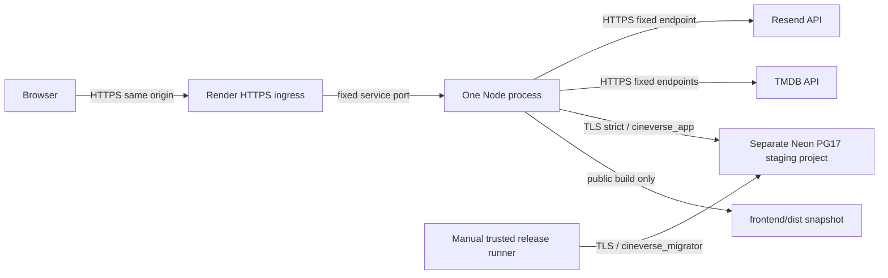

# Phase 9B — Render + Neon Free hosting readiness

Ngày xác minh tài liệu: **01/11/2026**. Baseline `8ab8403`.
Phase này thay hướng triển khai VPS trong [9A](phase-9a-staging-architecture.md)
bằng một Render Free Web Service + Neon Free theo yêu cầu mới. Tài liệu 9A giữ
nguyên làm lịch sử. Không tạo account/resource, billing, SSH, deploy, migrations
cloud, sửa `.env` thật hoặc commit/push.

**Kết luận:** source hỗ trợ hosting cùng origin, nhưng **chưa GO cho public
staging** khi Neon ACL, Render ingress trust và email delivery chưa được kiểm
chứng. Không hạ production guards để biến các blocker thành pass.

Ký hiệu: **[Local]** đã kiểm thử; **[Docs]** provider công bố; **[Cloud pending]**
cần tài khoản/môi trường thật và sự cho phép ở Phase 9C.

## 1. Vì sao thay hướng và kiến trúc

Mục tiêu mới là tránh vận hành VPS và không cần mua domain cho frontend ban đầu.
Render cấp HTTPS và hostname `onrender.com`, Node phục vụ cả SPA và API; Neon
giữ dữ liệu ngoài ephemeral filesystem của Render. Đây là staging/demo có quota
và cold starts, không phải cam kết production SLA hay mọi dịch vụ đều miễn phí.

Browser dùng `/api` tương đối như hiện tại, không CORS mới hoặc API origin thứ
hai. Vite dev proxy vẫn phục vụ local, không được dùng trong production.

## 2. Root causes và thay đổi

| Gap trước sửa | Cách xử lý [Local] |
| --- | --- |
| Backend chỉ API, Vite proxy không đi vào dist | `frontend.mjs` snapshot build riêng; API xử lý trước, deep links về index. |
| Bind cứng loopback:3001 | `runtime.mjs` yêu cầu hosting mode rõ ràng, validate HOST/PORT; local giữ loopback. |
| Offline preflight đòi cả migrator URL, startup không gọi | Tách runtime preflight, không cho migrator secret ở HTTP; giữ checker release hai role. |
| DB/ACL chỉ được kiểm tra khi auth request đầu tiên | Production startup gọi factory/ACL + query read-only trước listen. |
| Chưa health/readiness | Hai endpoints tối giản, deadline/cache/single-flight. |
| Shutdown đóng mọi socket ngay, không có deadline pool | Drain HTTP rồi disconnect DB; hard deadline hữu hạn. |
| Recovery chỉ SMTP, Render Free chặn SMTP | Giữ SMTP/Mailpit, thêm transport Resend HTTPS có bounded receipt/deadline. |
| Build dùng chung service environment | Script build loại credentials/VITE_* khỏi env của các child; từ chối checkout có env files thật. |

Files tạo: `backend/{runtime,health,frontend,deadline}.mjs`,
`backend/auth/resend-transport.mjs`, `scripts/build-render.mjs`,
`backend/tests/{hosting,email-https}.test.mjs`,
`frontend/tests/hosting.browser.cjs`, `deploy/render-runtime.env.example`,
tài liệu này. Files sửa: `backend/{index,server,production-readiness}.mjs`,
`backend/database/client.mjs`, `backend/auth/reset-email.mjs`,
`backend/.env.example`, root `package.json`, `scripts/test-browser.mjs`, README.
Không đổi React UI, dependencies/lockfiles, schema/migrations, session/CSRF/Origin.

## 3. Build/start thực tế và cấu hình Dashboard mẫu

**Chưa tạo Blueprint/resource.** Dùng hướng dẫn Dashboard thủ công để người dùng
review chi phí/settings trước bất kỳ bước tạo service nào.

| Render field [Plan] | Giá trị cần chọn ở 9C |
| --- | --- |
| Service | Một **Web Service**, runtime Node, instance **Free** |
| Source | Repository này, SHA được kiểm thử; root directory để trống |
| Node | `NODE_VERSION=22.23.4`, cùng `.node-version` của CI |
| Build command | `npm run build:render` |
| Start command | `npm start` → `node backend/index.mjs` |
| Health check | `/health/live` cho probes thường xuyên; xem tradeoff bên dưới |
| Auto deploy | **Off**, chỉ manual deploy SHA có cả hai CI jobs success |
| Database/disk/add-ons | Không tạo Render PostgreSQL, không disk/paid add-on |

Build script thực hiện tuần tự, dùng đúng hai lockfiles:

1. `npm ci --include=dev`.
2. `npm --prefix frontend ci --include=dev`.
3. `npm run db:generate` với môi trường offline `NODE_ENV=test`.
4. `npm run build` với `NODE_ENV=production`.

Không có DB query/migration hoặc email/TMDB request trong build. Prisma generate
tạo `backend/generated/prisma`; không commit generated client. Không prune mất
dependencies/Prisma trước bước cần chúng. Runtime artifact dùng Linux dependencies
do Render build, không copy Windows node_modules. Node version pin theo
[Render version configuration](https://render.com/docs/node-version).

Render cung cấp variables ở cả build/runtime. Script chỉ chuyển env OS tối thiểu
sang child, không chuyển service secrets hoặc `VITE_*`; kiểm tra không có `.env`,
`.env.production`… ở root/backend/frontend. `.env.example` được phép nhưng không
được load. Npm lifecycle scripts không nhận runtime/migration keys. Build process
cha vẫn ở provider secret boundary: bảo vệ quyền sửa build script và dependencies,
không coi env filtering là sandbox chống source độc hại.

## 4. Startup, bind, health và shutdown

Startup: validate binding/auth/runtime config → load bounded public dist nếu Render
→ kết nối DB qua `getPrisma()` (factory kiểm role/identity/ACL) + `SELECT 1`
→ listen → IPC ready cho dev khi thích hợp. Không có migrations trong HTTP startup.
Lỗi config/build/DB/port dùng thông báo an toàn và exit nonzero, không mở traffic.
Production/Render không load local backend `.env`; development giữ workflow cũ.

- Default `HOSTING_MODE=local`, host `127.0.0.1`, port `3001`; chỉ cho loopback
  IPv4/IPv6. NODE_ENV=production một mình không mở public bind.
- Render phải có **HOSTING_MODE=render + NODE_ENV=production + RENDER=true**;
  host chỉ `0.0.0.0`, PORT provider cấp phải là số 1–65535, không fallback khi thiếu.
  `RENDER=true` là xác nhận môi trường provider, **không phải chứng cứ proxy trust**.
- Startup deadline 15s gồm preflight/listen; shutdown deadline 10s. SIGTERM/SIGINT
  được coalesce, readiness chuyển false, ngừng nhận HTTP mới, drain request đang
  xử lý rồi disconnect pool. Hết deadline đóng sockets và exit 1. Không tự replay
  unsafe writes khi restart. Test bao gồm signal trong preflight và DB disconnect treo.

| Endpoint | Behavior [Local] |
| --- | --- |
| `GET /health/live` | 200 `{status:ok}`; không DB/TMDB/SMTP, không lộ version/host/credentials. |
| `GET /health/ready` | 200 hoặc 503 `{status:unavailable}`; query `SELECT 1` read-only qua factory hiện có. |
| Methods khác | 405 + Allow GET; health/API JSON no-store. |

Readiness dùng một underlying operation, response deadline 2s và cache boolean
30s; tất cả waiter dùng chung promise. Timeout không nhả slot khi driver còn chạy,
late success không đổi kết quả đã timeout. Driver đã có connection/query/statement
timeouts và runtime pool max 3. Không gọi upstream/mail hoặc catalog ACL scans ở
mỗi probe; factory kiểm ACL khi tạo client. Cache thành công có thể chậm nhận ra DB
outage tối đa 30s; readiness không thay authentication/authorization của mỗi request.

**Free-tier health tradeoff:** Render gửi health checks mỗi vài giây; nếu dùng
ready với DB dù cache 30s vẫn có thể giữ Neon compute awake. Chọn `/health/live`
cho provider sau khi startup đã bắt buộc DB/ACL pass; kiểm `/health/ready` theo
nhu cầu operator/smoke, không tạo cron/uptime ping giữ service thức. Tradeoff: DB
outage không làm Render tự restart theo liveness; API báo lỗi/Retry, operator phải
theo dõi riêng. Nếu cần readiness liên tục, review compute budget trước khi đổi.
[Health policy](https://render.com/docs/health-checks).

## 5. Static serving, routing và performance

- Snapshot chỉ `frontend/dist`, không dựng filesystem path từ request. Không
  directory listing, dotfiles, source maps, backend/source paths; chặn traversal,
  backslash, invalid encodings, symlinks trong build. Build thiếu index bị từ chối.
- Bounds: depth 8, 1024 directory entries, 512 served files, 8MiB/file, 32MiB tổng
  buffers (kể cả gzip/Brotli). Artifact read-only theo release, refresh snapshot khi restart.
- `/api` và `/api/*` luôn qua API handler; unknown API trả JSON 404, không HTML.
  `/health/*` cũng không SPA fallback. Missing `/assets/*`/file extension trả 404.
  Route giao diện extensionless dùng index để React Router xử lý NotFound.
- Đúng MIME/nosniff; HTML và assets không hash no-store. Hashed `/assets/*` immutable
  1 năm; gzip/Brotli cho text/SVG, `Vary: Accept-Encoding`, HEAD không body.
- Frontend lazy routes, responsive images và attribution không đổi. Không preload
  toàn bộ phim. Release mới có thể làm mất chunk cũ: trả 404 thật để RouteBoundary
  hiện explicit reload; không dùng HTML 200 giả cho chunk bị mất.
- Giữ no-referrer/no-store recovery, fragment scrub trước bootstrap. Public dist
  tuyệt đối không chứa credentials, kể cả khi chúng không có prefix VITE_.

## 6. Cookie, CSRF, Origin và Render ingress

`https://<service>.onrender.com` phục vụ document lẫn `/api`. Browser vẫn dùng
credentials same-origin. Giữ cookie `__Host-cineverse_session`, Secure, HttpOnly,
SameSite=Lax, Path=/, **không Domain**. HTTPS terminate ở Render, socket nội bộ
HTTP không làm tắt Secure; code không suy ra cookie flags từ X-Forwarded-Proto.
AUTH_ALLOWED_ORIGINS/PUBLIC_APP_ORIGIN là cùng canonical HTTPS origin chính xác.
Không dùng wildcard, CORS mới hay chia cookie giữa các hostname onrender tùy ý.

Origin/Sec-Fetch-Site/custom CSRF header giữ nguyên. Account binding, auth epoch,
BroadcastChannel/storage/focus revalidation và stale-response protection giữ nguyên.
Proxy phải forward Cookie, Set-Cookie, Origin và account/CSRF headers nguyên vẹn;
không inject hộ chúng. Reset links dựng từ PUBLIC_APP_ORIGIN, không Host/XFF.

**Trust policy chưa xác minh trên Render:** default TRUSTED_PROXY_CIDRS rỗng →
socket-only, bỏ qua mọi XFF, X-Real-IP/CF header do client khai. Điều này bảo thủ,
không bypass quota, nhưng nhiều khách có thể chia quota của proxy peer. Không tự
thêm private CIDR rộng, trust-all hoặc dùng outbound IP list thay ingress list.
Source vẫn hỗ trợ CIDR hữu hạn đã review và chain phải-sang-trái theo 7B.2.
9C phải có tài liệu/provider proof về peer + overwrite/append chain rồi thử hai
client thật và spoofed XFF; không chứng minh được → **blocker public staging**,
không bỏ bảo vệ để cho deploy chạy. RENDER=true không giải quyết vấn đề này.

## 7. Neon PG17, Prisma và least privilege

[Neon hỗ trợ PG17](https://neon.com/blog/postgres-17),
[Prisma integration](https://neon.com/docs/guides/prisma) và
[TLS](https://neon.com/docs/security/security-overview) có tài liệu. Dùng PG17
project mới, không clone local/production; chọn cùng region với Render nếu có,
nhưng latency/network/SSL/permissions thực tế **Cloud pending**.

Giữ nguyên contract của 7B.4:

- Database `cineverse_prod`, schema public, **trong project staging độc lập**.
- Runtime `cineverse_app`, migrator `cineverse_migrator`, secrets khác nhau; runtime
  không owner/DDL/history/grant option, chỉ CRUD bốn bảng. Không membership/elevated flags.
- `DATABASE_URL` chỉ runtime; `MIGRATION_DATABASE_URL` chỉ release runner, HTTP
  startup từ chối nonempty migration variable. Không dùng provider owner URL cho app.
- Pinned direct FQDN:5432, runtime max 3 connections, migration 1. PrismaPg/pg TCP
  giữ nguyên; **chưa duyệt pooled endpoint** `-pooler`/transaction pooling vì session
  identity/ACL/options phải test riêng. Không switch sang Neon serverless adapter.
- DSN dùng schema=public, sslmode=require, sslaccept=strict; builder thực sự đặt
  rejectUnauthorized + servername. Không copy thêm channel_binding/options tùy ý
  ngoài query allowlist; nếu provider bắt buộc điều khác, review riêng trước đổi.
  Public CA default của Node hoặc CA bundle public hợp lệ; không accept-invalid-cert.

**Role feasibility chưa được chứng minh:** theo [roles](https://neon.com/docs/manage/roles),
roles tạo qua Console/API/CLI có neon_superuser membership, không đạt guards.
SQL-created roles có thể selective grants, nhưng chưa chứng minh được revoke
PUBLIC CONNECT/TEMP mọi DB hệ thống, schema/object ownership, extra schema/routines
và metadata đầy đủ. [Access control](https://neon.com/docs/manage/database-access).
Không chạy nguyên native provisioning script lên Neon: DBA phải review quyền và
cách đặt passwords của provider, tránh SQL history/logs; không dùng source chứa
password hoặc mặc định native `psql \password` tương thích mọi provider.

Gate bắt buộc: kiểm metadata thực của **cả hai role**, identity/session_user,
flags/memberships, otherDatabaseConnect=false, schema/table/column/sequence/routine
ACL, ownership sau migrate và negative DDL/history tests. Chưa thay các guards.
Nếu provider không cho revoke/đạt contract: **NO-GO** với policy hiện tại.

Phương án tương đương chỉ để review riêng: project/branch isolated, runtime SQL
role CRUD allowlist, provider-owned system-object access được inventory/allowlist
cụ thể thay blanket exception. Residual risk gồm metadata/cross-database access,
provider memberships/routines; phải có threat model và negative tests trước khi
đổi contract. Không áp dụng phương án này trong 9B, không âm thầm nâng quyền app.

## 8. Password recovery qua HTTPS

Render Free chặn SMTP 25/465/587. Adapter Resend mới dùng fixed
`https://api.resend.com/emails`, Bearer sending key server-only, plain text email,
redirect=error, không retry tự động, deadline 5s + AbortController, receipt tối đa
8KiB/UUID hợp lệ. Error/quota/network/JSON sai đều thành EMAIL_UNAVAILABLE 503
an toàn; không log provider message, key, URL reset hoặc email. [API contract](https://resend.com/docs/api-reference/emails/send-email).

SMTP/Mailpit và disabled mode local không đổi. Render startup đòi mode=resend
hợp lệ; không âm thầm bỏ recovery. Public message known/unknown như nhau; cả hai
đi cùng transport, token chỉ ở DB hash/email, TTL vẫn 20 phút, delivery lỗi xóa
token tương ứng như trước. Không đổi rate limits, CSRF/Origin hoặc reset flow.

Resend Free công bố 3,000 emails/tháng và 100/ngày; **sender verification và inbox
delivery chưa test**. Shared resend.dev test sender chỉ gửi tới email tài khoản
provider; không đủ cho recovery nhiều tester. Muốn người nhận khác cần domain
sender đã verify. Frontend không cần domain trả phí nhưng email domain vẫn có
thể là blocker/chi phí nếu chưa sở hữu. Không tạo tài khoản/key hoặc gửi thư thật.
[Pricing](https://resend.com/pricing), [test-domain restriction](https://resend.com/docs/knowledge-base/403-error-resend-dev-domain).
Tắt click/open tracking reset links, xác minh SPF/DKIM/DMARC và quota trước public use.

## 9. Environment và migration workflow riêng

Template chỉ placeholders: [render-runtime.env.example](../deploy/render-runtime.env.example).

| Scope | Names | Quy tắc |
| --- | --- | --- |
| Build public | NODE_VERSION | Pin như CI; không cần DB/TMDB/email credentials cho build child. |
| Runtime public | NODE_ENV, HOSTING_MODE, HOST, PORT, RENDER, AUTH_ALLOWED_ORIGINS, PUBLIC_APP_ORIGIN | Render explicit mode/port, một HTTPS origin; PORT/RENDER do provider cấp. |
| Runtime DB | DATABASE_URL (secret), PRODUCTION_DATABASE_HOST, DATABASE_SSL_CA_FILE | App role/direct strict TLS; không driver overrides ngoài allowlist. |
| Runtime upstream | TMDB_READ_ACCESS_TOKEN (secret), TMDB_MAX_CONCURRENT, TMDB_MAX_QUEUE | Server-only, bounds/scheduler cũ. |
| Runtime mail | PASSWORD_RESET_EMAIL_MODE=resend, SMTP_FROM, RESEND_API_KEY (secret) | SMTP_FROM tái sử dụng tên hiện có cho sender của mọi transport. |
| Runtime proxy | TRUSTED_PROXY_CIDRS | Để rỗng cho tới khi có ingress proof; không coi default là public-ready. |
| Release-only | MIGRATION_DATABASE_URL (secret), runtime URL tạm cho offline comparison, pinned DB/TLS config | Chỉ trong task tin cậy; không Environment Group dùng chung HTTP. |
| Local-only | SMTP_HOST/PORT/SECURE/USER/PASSWORD, local .env | Giữ workflow local; không ship .env lên Render. |

Render Free không có shell/one-off jobs. Migration thực hiện thủ công trên clean
checkout đúng SHA ở máy/operator runner tin cậy, không cần SSH tới Render. Chỉ
sau phê duyệt 9C: tạo project riêng → DBA roles/ACL/TLS → backup nếu đã có dữ liệu
→ inject release secrets qua secure channel → `npm run check:production-config`
→ `npm run db:deploy:production` → DBA explicit runtime grants →
`npm run db:roles:check` với app identity → đóng/revoke release secret scope →
manual deploy app đúng SHA. Không migrate trong build/start, migrate dev/db push/reset.
Full release checker vẫn đòi hai role/secret khác nhau; runtime checker không đòi
migrator. Generated client/schema/migrations phải có ở release runner từ build sạch.

## 10. Free limitations, cost và rollback

- Render Free có thể ngủ sau 15 phút, wake khoảng một phút; không persistent disk,
  shell hay multi-instance. Neon giữ dữ liệu độc lập. Không dùng Render DB Free
  hết hạn 30 ngày. [Free limits](https://render.com/docs/free), [web service/port](https://render.com/docs/web-services).
- Neon Free hiện 100 CUh/project/tháng, 1GB/project, 5GB transfer; scale-to-zero
  sau 5 phút. Dùng hết compute/transfer có thể suspend; quota storage làm writes
  thất bại. Restore window ngắn không thay backup dài hạn. [Neon pricing](https://neon.com/pricing).
- Đích $0 trong quotas, không cam kết đủ cho 24/7: 0.25 CU × 730h ≈ 182.5CUh
  nếu luôn awake. Không bật billing/auto-upgrade/add-ons/preview resources; owner
  review quotas và alerts. Không cố ping giữ free thức, không tự đổi plan khi lỗi.
- Một process: rate limit/scheduler per-process; restart/rolling overlap thay quota.
  Không autoscale, không gọi thiết kế này distributed abuse protection.
- Frontend deadline 12s không tăng. Cold first document/API path cần đo trên Render;
  giữ loading/error/Retry, không timeout-loop hoặc retry unsafe write tự động.

Rollback app: manual chọn artifact/SHA trước tương thích schema, đối chiếu env/key
versions; không reset Git hay reverse migration. Render rollback có khôi phục một
số service settings, shared groups/edge rules có ngoại lệ. [Rollback docs](https://render.com/docs/rollbacks).
Đừng giả định secret cũ còn hợp lệ hoặc SQL đã quay lại. Nếu DB incompatible: giữ
service ở trạng thái không nhận traffic, DBA forward-fix hoặc restore sang project
test riêng đã được phép. Backup encrypt/off-provider + restore rehearsal, không
coi Free restore window là DR. Không đưa backup/session/reset state vào Git/logs;
trước traffic sau restore phải review/invalidate sessions/reset tokens để không
hồi sinh credentials đã revoke. Những thao tác này chưa chạy trong 9B.

## 11. Test evidence và giới hạn

Xem bảng kết quả local ở cuối tài liệu sau khi gates hoàn tất. Tests gồm static/API
precedence, traversal/private files/missing chunks, compressed cache/MIME, binding,
startup fail-closed, deadlines, graceful HTTP drain, signals, strict Neon-shaped
config, production cookie/CSRF/account binding và HTTPS mail mock.

Production browser suite mới chạy Node + dist thật, không Vite proxy: lazy route
loading, MovieCard/deep link/refresh/Back–Forward, Profile return qua Login,
mobile reflow và missing-chunk explicit reload. Account/movie responses là fixtures;
không thay tests auth/session thật trong bộ regression hiện có.

Quality gates chạy trên bản sao Git-visible source ban đầu không `.env`, dependencies
hay dist; build dùng npm ci mới theo lockfiles, không copy node_modules máy dev.
Prisma validation và browser suites chạy trong bản sao không env, tránh đọc local
credentials. Native PG tests tạo cluster riêng/cổng khác 5432; không chạy db:check
với local credentials. Database metadata/ACL checks có trong native tests; cloud
TLS/ACL không được suy ra từ chúng. Windows/Edge local không thay Linux/Render.

Failure Change Password cũ vẫn **chưa resolved**: giữ [investigation](ci-change-password-investigation.md)
và safe diagnostics; không xóa assertion, tăng timeout hoặc nhận rằng run xanh
chứng minh root cause đã sửa. Phase 9B chưa commit/push nên chưa có CI run cho patch này.

## 12. Blockers và checklist Phase 9C

| Blocker | Bằng chứng cần có trước public traffic |
| --- | --- |
| Neon ACL contract | Hai role thực pass inspect/negative tests, schema/history/ownership, PUBLIC/system DB access; không provider-owner runtime. |
| Render client IP | Ingress peer/overwrite chain được xác minh; hai client độc lập, spoof XFF không bypass, API/cookies qua edge đúng. |
| Email | Sender/domain/inboxes/quota, HTTPS delivery known/unknown và reset token expiry/reuse/revocation, tracking off. |
| Cloud startup/cost | Cold start, memory/Argon2, TLS CA/hostname failures, Neon connection limits/idle, health không gây awake liên tục. |
| Recovery/rollout | Backup/restore + app rollback rehearsal, old chunks, database downtime và in-flight writes/session revocation. |

Cho người mới học, thứ tự thao tác **chỉ sau khi được phép tạo resources**:

1. Review blockers/cost; chọn cùng region, project staging mới, không dữ liệu thật.
2. Tạo Neon PG17, làm role/ACL feasibility trước; không đạt thì dừng xin review,
   không sửa guard. Đặt secrets qua provider/secure channel, không chat/Git.
3. Chuẩn bị email sender/key có quyền gửi tối thiểu; verify domain/test inbox.
4. Chuẩn bị clean release runner, backup/role/TLS/migration/grants đúng thứ tự trên.
5. Review Dashboard Render fields/env template; Auto Deploy Off, Free, không add-ons.
6. Chỉ manual deploy SHA cả hai CI jobs xanh. Kiểm health/live + ready, direct
   URL/refresh, JSON errors, gzip/cache và không token trong frontend/response.
7. Test HTTPS Login/Logout/Me/Favorites/Profile/Change Password/Reset, expired
   session, hai tab A/B; xác minh Secure/HttpOnly/host-only/CSRF/account binding.
8. Kiểm idle/cold path, proxy spoof/two-client quotas, backup/restore, chunk recovery,
   accessibility/keyboard và thiết bị thật. Chưa kết luận production ready chỉ vì port mở.

Không provision/deploy/commit/push trong phase này.

## 13. Kết quả kiểm tra cuối Phase 9B [Local]

Môi trường: Windows, Node **22.23.4**, Edge headless; production dist qua HTTP
Node thật trên ephemeral loopback, HTTPS edge được mô phỏng bằng production
config/headers trong HTTP tests. **Chưa có browser HTTPS trên Render thật.**

| Gate thực sự đã chạy | Kết quả |
| --- | --- |
| Clean build `npm run build:render` | Exit 0 từ source copy ban đầu không node_modules/dist/env; npm ci cả hai lockfiles, generate và build đạt. |
| Automated backend/frontend | **308 + 112 = 420 tests đạt**, gồm 19 tests mới cho hosting/email. |
| `npm run check` | Exit 0: tests, lint, TypeScript, production build, Prisma validation và full browser regression. |
| Lint | 0 warnings/errors; bản sao được đặt Git boundary riêng để không bị parent .npm-cache ignore toàn bộ. Lượt đầu 0 files là lỗi setup đã sửa, không tính là pass. |
| Production hosting browser mới | Node/dist same-origin, lazy route, movie link, direct/refresh/Back–Forward, Profile return, mobile và chunk failure/reload đạt. |
| Auth/Favorites/Profile/Change Password | Full browser regression đạt; Change Password 7 nhóm, multi-tab **22 checkpoints** đạt. |
| Accessibility | 50 pages + 39 states, không violation/overflow/keyboard failure trong phạm vi kiểm tra. |
| Advanced UX | 34 snapshots/37 checks đạt, 0 overflow/unexpected forced-color findings; giữ hai contrast reviews đã có từ 8C. |
| Native PostgreSQL 17 | **14/14 đạt**, cluster mới/cổng khác 5432 trong source copy, shutdown xác nhận; không chọn database local của người dùng. |
| Read-only database/ACL checks | Native suite kiểm metadata, role permissions và transaction concurrency; không kết nối Neon hoặc database local để đọc credentials. |
| Source consistency | Hash các source backend/frontend/scripts/package đã thử không đổi trong khi full gates chạy. |
| Secret review | 299 Git-visible files + 22 commits/474 history blobs: pattern scan 0 findings sau các fixtures/checksums đã review; thêm Resend key pattern 0 findings. Không load env/real credentials để fingerprint. |
| Documentation | Relative links tồn tại, whitespace/fences hợp lệ; git diff --check đạt. |

Ghi chú: source copy không phải GitHub-hosted clean checkout; dependencies được
cài mới từ lockfiles bằng build script trên Windows. Lint cần Git boundary cục bộ
vì copy nằm trong ignored `.npm-cache`; không commit vào repository copy đó.
Không tuyên bố CI/Linux/cloud pass cho changeset chưa push. Chỉ sửa tài liệu sau
gates để thêm bảng bằng chứng này; runtime source đã thử không đổi.
